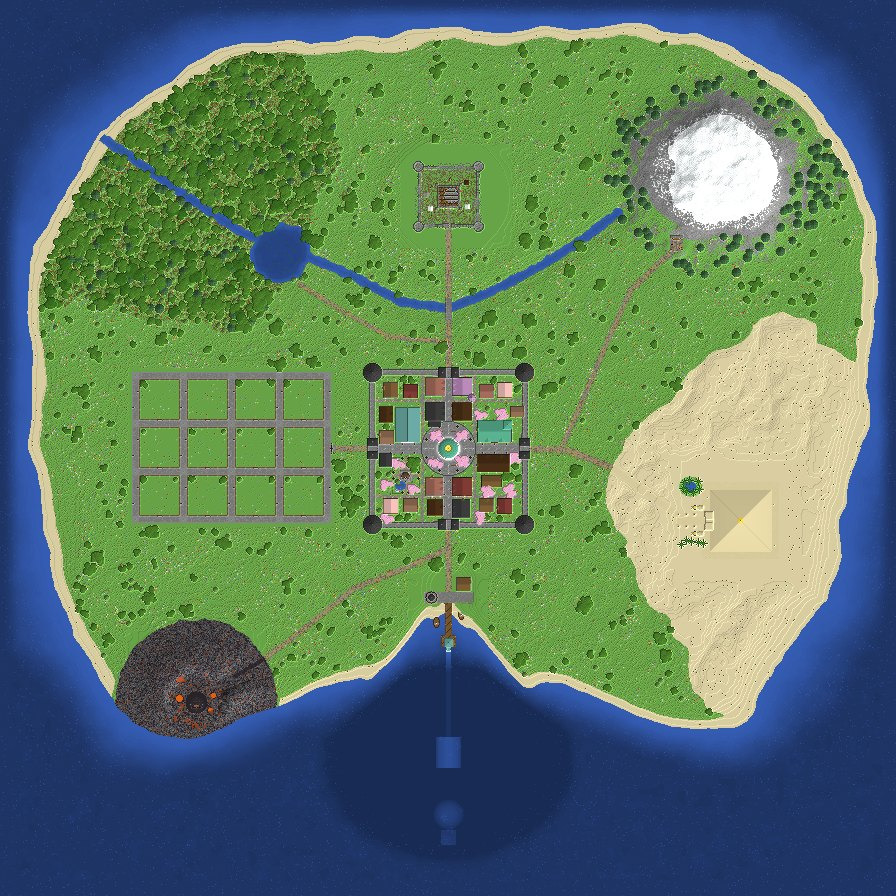

# 베어 RPG V1 — Minecraft Bedrock RPG 맵

`BearRPG_V1.mcworld` 하나로 바로 플레이할 수 있는 베드락 에디션용 RPG 맵입니다.
스폰 도시, 상점가, 대형 개인 집터, 그리고 7개의 던전(초원 · 동굴 · 사막 · 바다 · 지옥 · 네더 요새 · 피글린 요새)이 들어 있습니다.



## 설치

1. `BearRPG_V1.mcworld` 를 내려받아 실행(더블클릭 / 열기)하면 Minecraft가 월드를 가져옵니다.
2. 월드 목록에서 **베어 RPG V1** 을 선택해 시작합니다.

- 필요 버전: **Minecraft Bedrock 1.21.0 이상**
- 행동 팩 **BearRPG_BP_V1** 이 월드에 포함되어 자동 적용됩니다(상점 · 워프 · 보스 · 보상 시스템).
- 명령 블록을 쓰기 때문에 치트가 켜져 있습니다(업적 비활성).

## 구성

| 구역 | 위치 (x, z) | 내용 |
|---|---|---|
| 스폰 · 베어 타운 | 0, 0 | 성벽·성문 4곳·모서리 탑, 대리석 스폰 로툰다(구리 돔 + 신호기), 공원과 곰 동상 |
| 상점가 | 북쪽 대로 | 무기점(대장간) · 방어구점 · 도구점 · 마법 상점(마법사 탑) · 식료품점 |
| 차원문 신전 | 서쪽 대로 북편 | 발판을 밟으면 모든 던전 / 집터로 이동 |
| 모험가 길드 | 동쪽 대로 북편 | 전리품 매입소(16종), 의뢰 게시판, 종탑 |
| 곰발바닥 여관 | 동쪽 대로 남편 | 객실(침대 사용 가능), 마구간 |
| 개인 집터 | -216, 0 | 41×41 대형 필지 **12곳**, 포장도로·가로등, 이름표·우편함 |
| 초원 던전 | 0, -252 | 폐허의 성채: 지상 폐허 + 지하 묘지 → 보스 「폐허의 왕」 |
| 동굴 던전 | 228, -206 | 수정 동굴: 광산 → 이끼 동굴 → 종유석 호수 → 자수정 정동 → 심층 제단 |
| 사막 던전 | 292, 72 | 태양왕의 피라미드: 오벨리스크 참배로, 지하 대회랑, 왕의 방 |
| 바다 던전 | 0, 312 | 항구·등대 → 바닷속 유리 터널 → 가라앉은 신전(전달체, 엘더 가디언) |
| 지옥문 | -252, 252 | 화산 분화구의 차원문 → 네더 허브 |
| 지옥 던전 | 네더 | 불타는 협곡: 용암 협곡 → 진홍/뒤틀린 숲 → 영혼 모래 계곡 → 용암 투기장 |
| 네더 요새 | 네더 | 위더의 성채: 용암 바다 위 요새, 블레이즈 탑, 군주의 전당(+선택형 위더 도전) |
| 피글린 요새 | 네더 | 황금 보루: 성벽·호글린 우리·주거지·보물 전당 |

미리보기 이미지는 [`preview/`](preview) 폴더에 있습니다.

## 게임 시스템

- **골드**: 화면 오른쪽 점수판에 표시됩니다. 처음 접속하면 50 골드와 기본 장비를 받습니다.
  - 버는 법: 던전 클리어 보상, 길드에서 전리품 판매(썩은 살점·뼈·화약·블레이즈 막대·광물 등)
  - 쓰는 법: 상점의 표지판 아래 **버튼**을 누르면 구매됩니다(전용 이름·마법이 붙은 장비 포함).
- **던전**: 보스방에 들어서면 보스가 나타나고, 처치 후 보상 제단의 버튼을 누르면 골드를 받습니다.
  최초 클리어 때는 큰 보상 + 특별 장비, 이후에는 반복 보상을 받습니다. 제단 옆 푸른 발판은 마을 귀환입니다.
- **권장 순서**: 초원(150) → 동굴(300) → 사막(450) → 바다(650) → 지옥(900) → 네더 요새(1300) → 피글린 요새(1600)
  7곳을 모두 클리어하면 「전설의 용사」 칭호와 용사의 검을 받습니다.
- **구역별 게임 모드**: 마을과 던전은 모험 모드(건축물 보호), 그 밖의 들판과 집터는 서바이벌 모드로 자동 전환됩니다.
- 기타 규칙: 인벤토리 유지, 몹의 블록 파괴 없음, 불 번짐 없음, PvP 꺼짐.

### 관리자용 명령

```
/tag @s add bear_admin              구역별 게임 모드 전환에서 제외
/function bear/admin/zones_off      구역별 게임 모드 전환 끄기 (zones_on 으로 다시 켜기)
/function bear/admin/gold           1000 골드 받기
/function bear/admin/reset_bosses   보스 상태 초기화
```

## 직접 다시 만들기

맵은 전부 `gen/` 의 Python 생성기로 만들어집니다.

```bash
pip install "amulet-leveldb<1.1" numpy pillow     # Python 3.11
python build.py            # out/world + BearRPG_V1.mcworld + pack/BearRPG_BP_V1 생성 (약 20초)
python verify_routes.py    # 모든 던전의 입구→보스→보상 경로가 실제로 이동 가능한지 탐색
python verify_leaks.py     # 물/용암이 새는 곳이 없는지 검사
python verify_signs.py     # 표지판 글자 수 검사
python preview.py          # preview/ 이미지 다시 렌더링
```

| 파일 | 역할 |
|---|---|
| `gen/core.py`, `gen/blocks.py` | 블록 상태 레지스트리(1.21.0 블록 표로 검증), 월드 볼륨, NBT |
| `gen/bedrock.py` | LevelDB 청크 기록(서브청크 v9 · Data3D), level.dat, mcworld 압축 |
| `gen/kit.py`, `gen/houses.py` | 지붕·탑·소품·나무, 목조 가옥 생성기 |
| `gen/terrain.py` | 섬 지형, 강·호수, 도로, 광석, 식생 |
| `gen/hub.py`, `gen/town.py`, `gen/plots.py` | 성곽 도시, 상점·신전·길드·여관, 집터 단지 |
| `gen/d_*.py`, `gen/nether.py`, `gen/n_*.py` | 던전 7곳과 네더 차원 |
| `gen/systems.py`, `gen/catalog.py` | 행동 팩 V1(함수·전리품 표), 상점 품목과 보상 |
| `gen/check.py`, `gen/walk.py` | 명령 블록 연결·경로 검증 도구 |

## 검증 범위

이 맵은 게임 클라이언트 없이 생성되었습니다. 대신 아래 항목을 자동으로 확인했습니다.

- Amulet으로 완성된 월드를 다시 읽어 청크 3,904개(오버월드 3,136 + 네더 768)와 블록 엔티티가 모두 정상 판독됨
- 사용한 모든 블록 상태를 Bedrock 1.21.0 블록 표와 대조
- 상점 91개 품목·워프·보스·보상 함수가 빠짐없이 명령 블록에 연결됨
- 모든 던전의 입구 → 보스방 → 보상 제단 → 귀환 발판 경로가 이동 가능함(난수 조건을 바꿔 반복 확인)
- 건조 구역(해저 터널·아트리움 등)으로 물이나 용암이 새는 곳이 없음

실제 Minecraft에서의 플레이 테스트는 하지 못했으므로, 처음 열었을 때 이상한 점이 보이면 알려 주세요.
